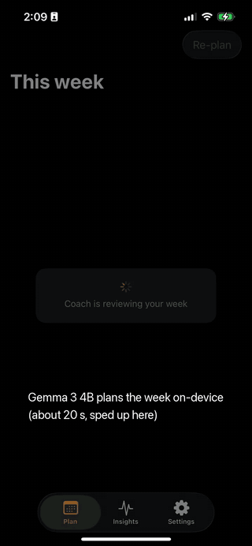

# OpenStride

An AI running coach for iPhone that reads your own data from Apple Health and plans your week with Gemma, an open-weight model running on the phone. With the on-device model (the default), your health data stays on the phone.

Built for the DEV Hacktoberfest 2026 Open-Source AI Challenge, Week 2 ("Side Hustle").

**Demo:** [ansh-saini.github.io/open-stride](https://ansh-saini.github.io/open-stride) (60 s video recorded on an iPhone 13 Pro)



## Why

Nike Run Club plans are templates. They don't know your resting heart rate, your actual paces, or that you doubled your mileage last week. OpenStride does:

- **Heart rate zones** from your resting HR and the highest HR seen in your runs (Karvonen method)
- **Pace zones** from your best recent effort (Jack Daniels' VDOT)
- **Training load** per run (Banister TRIMP) and the 7-day vs 28-day load ratio
- **HR drift** between the first and second half of each run
- **Last week's completion** against what was planned

Every week the coach looks at those signals and adjusts the plan, and tells you why in plain words.

## How it works

```
Apple Health ──> HealthKitProvider ──> runs, HR, resting HR, VO2 max, age
                                          │
                          CoachKit (pure Swift, unit tested)
          MetricsCalculator: zones, VDOT, paces, load ratio, drift, weekly km
          PlanEngine: phase (base/build/peak/taper), weekly volume, sessions
          CoachAgent: signals -> Gemma -> JSON decision -> guardrails
                                          │
          LLMClient: MLX on iPhone (CoachMLX) | Ollama (Mac, simulator, eval)
```

Math lives in code. Judgment lives in the model. The plan engine builds a draft week from your numbers. Code turns your metrics into signals with fixed thresholds (OK or FLAG). Gemma reads the signals and the draft, then picks adjustments from a small action set (`make_easy`, `shorten`, `drop`, cut volume, slow easy pace). After guardrails, a second Gemma call writes the note to you from facts code computed about the final plan, so the note always matches what you see.

Guardrails apply after the model and can't be argued with:

- No flagged signal: the draft stands, whatever the model asked for
- Flagged signal with too small a response: a floor applies (for example, load ratio above 1.5 means at least 20% less volume)
- The long run can't be dropped, and at most one run is dropped per week
- At most one hard session when the load ratio is above 1.5, none after 14+ days off
- Weekly volume capped at 110% of your 4-week average plus 2 km

If the model fails (bad JSON, timeout), a rule-based coach writes the week instead. The app never breaks because of the model.

## Eval harness

`coach-eval` (Ollama) and `mlx-eval` (MLX, same weights as the phone) run six synthetic runners through the coach and score each decision:

| Persona | Signal | A good coach should |
|---|---|---|
| steady | all normal | keep progressing |
| overreaching | load ratio 1.98 | cut volume, max one hard day |
| detrained | 21 days off | no hard sessions |
| hr_drift | 7.7% HR drift | slow easy pace |
| missed_sessions | did 20% of last week | not add volume |
| beginner | 8 km/week | keep progressing, gently |

Columns: **valid** (parseable decision), **final** (plan after guardrails is right), **model** (right without a guardrail floor stepping in), **msg-kept** (model's message matched the final plan), **cites#** (message names a number).

See [`eval/RESULTS.md`](eval/RESULTS.md) for the latest numbers.

## Pricing

One-time purchase on the App Store and Google Play: **$10 (₹599 in India)**. No subscription or account.

Sample store listing with screenshots and copy: [ansh-saini.github.io/open-stride/appstore](https://ansh-saini.github.io/open-stride/appstore/) (assets in `docs/appstore`).

The coach runs on the phone, so a user costs nothing to serve after they buy. There's no server bill to pass on every month. The app is iOS only today; the Play Store listing comes with the Android version.

## Run it

Requirements: Xcode 26, an iPhone with Apple Health data (Apple Watch runs give the best signal), XcodeGen.

```sh
cd App
xcodegen generate
open OpenStride.xcodeproj   # trust the MLXHuggingFace macro when Xcode asks, pick your team, run on device
```

On first plan, the app downloads Gemma 3 4B (2.6 GB, 4-bit MLX) once. After that it runs offline. A plan takes about 20 seconds on an iPhone 13 Pro (6 GB RAM). If a phone runs out of memory, the app drops to Gemma 3 1B on the next launch and says so. Settings has Gemma 3 1B (0.8 GB) for older phones, an Ollama option, and sample runners for trying it without Health data.

The simulator can't run MLX, so it uses Ollama on your Mac:

```sh
brew install ollama && brew services start ollama
ollama pull gemma3:4b
```

Tests and evals:

```sh
cd CoachKit && swift test
swift run coach-eval --models rules,gemma3:1b,gemma3:4b --runs 3 --show

cd ../CoachMLX
xcodebuild -scheme mlx-eval -destination 'platform=macOS' -derivedDataPath .build-xc -skipMacroValidation build
./.build-xc/Build/Products/Debug/mlx-eval --model 4b --runs 3 --show
```

Launch arguments for demos: `-demo overreaching -backend 4b -tab insights`. `-dumpData YES` writes the parsed Health data to the app container; `swift run coach-eval --athlete athlete-dump.json` replays it on a Mac.

UI tests: `HealthFlowTests` (simulator; seeds sample data into the simulator's Health) and `DeviceFlowTests` (real iPhone, real Health, read-only; run with `-only-testing:OpenStrideUITests/DeviceFlowTests`).

## Not medical advice

OpenStride is a training tool and does not give medical advice. Stop and get checked if something hurts.

## License

MIT
