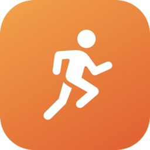
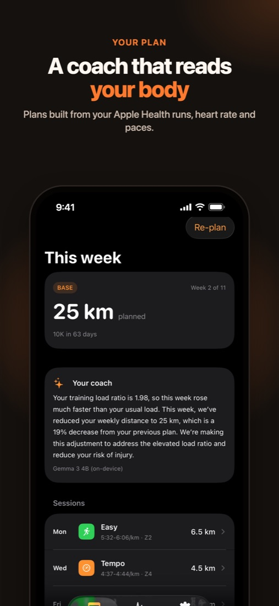
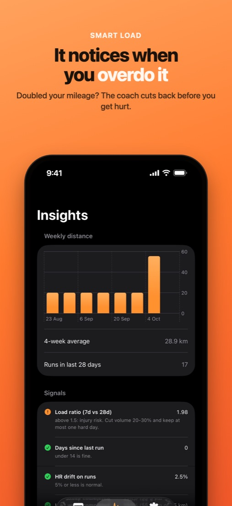
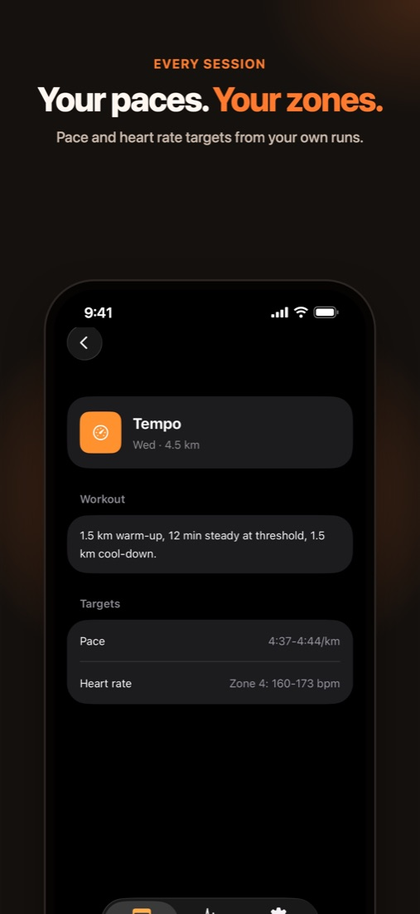
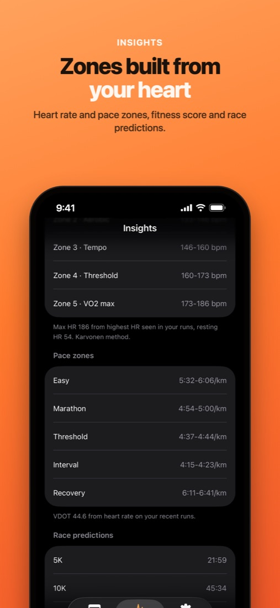
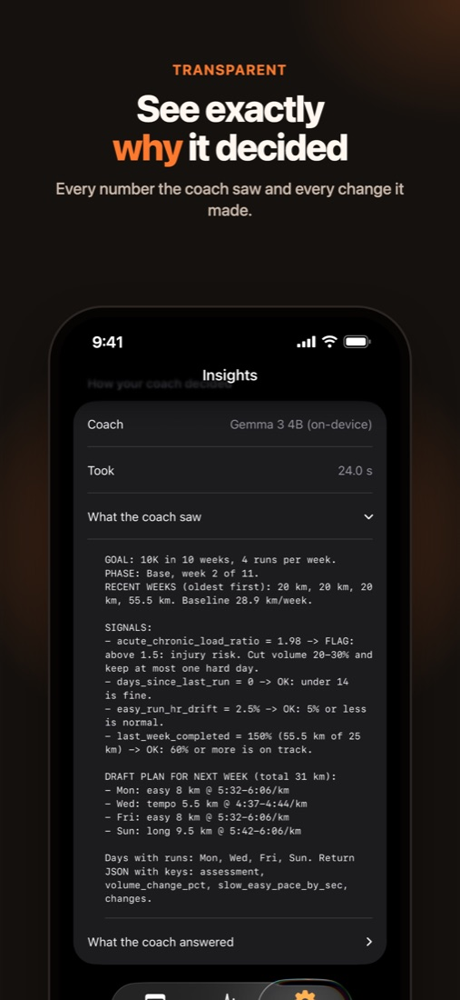
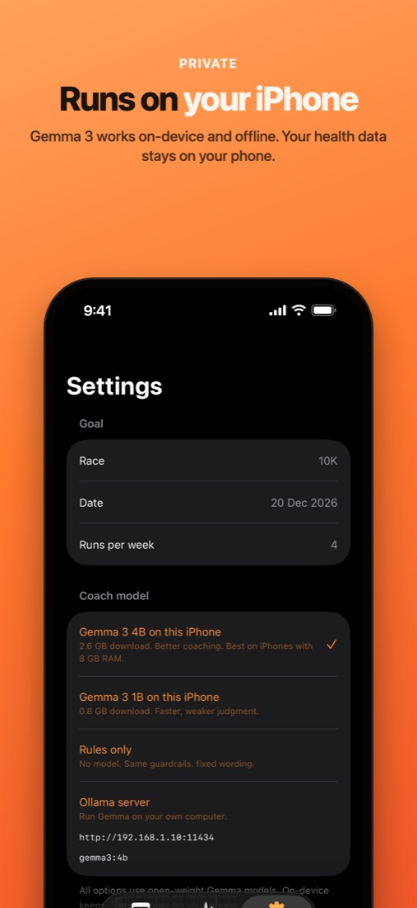
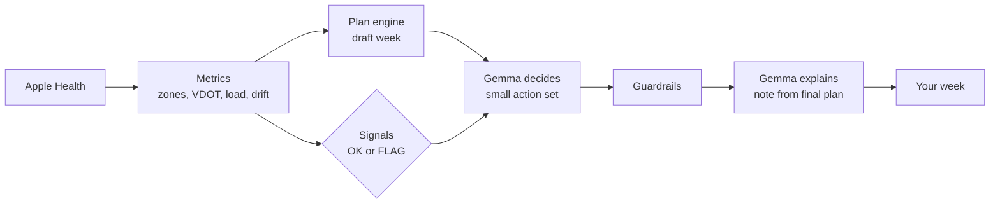

<div align="center">



# OpenStride

**An AI running coach that reads your body and runs on your iPhone.**

OpenStride reads your runs and heart rate from Apple Health, works out your zones and training load,<br>
and plans each week with Gemma 3, an open-weight model running on the phone.

[](#run-it)
[](#run-it)
[](#how-it-works)
[](https://github.com/ml-explore/mlx-swift-lm)
[](LICENSE)

[**Demo video**](https://ansh-saini.github.io/open-stride) &nbsp;·&nbsp; [**Store listing**](https://ansh-saini.github.io/open-stride/appstore/) &nbsp;·&nbsp; [**How it works**](#how-it-works) &nbsp;·&nbsp; [**Results**](#results)

<br>








</div>

<br>

## Why

Nike Run Club plans are templates. They don't know your resting heart rate, your actual paces, or that you doubled your mileage last week. OpenStride builds the plan from your own numbers and changes it when they change.

| | What it reads | How |
|---|---|---|
| **Heart rate zones** | Resting HR and the highest HR seen in your runs | Karvonen method |
| **Pace zones** | Your best recent effort, or pace plus heart rate | Jack Daniels' VDOT |
| **Training load** | Every run's duration and heart rate | Banister TRIMP, 7-day vs 28-day ratio |
| **HR drift** | First half vs second half of each run | Percent rise on easy runs |
| **Completion** | Last week's plan against what you ran | Percent of planned distance |

Every week the coach reviews those signals, adjusts the plan, and tells you why in a short note.

## How it works

Small models are bad at arithmetic and good at reading a situation, so the math lives in code and the judgment lives in the model.



1. **Measure.** `CoachKit` computes zones, paces, load ratio, drift and weekly volume. Pure Swift, unit tested.
2. **Draft.** The plan engine builds the week: phase (base, build, peak, taper), volume, long run and quality sessions.
3. **Decide.** Gemma reads the signals and the draft, then picks from `make_easy`, `shorten`, `drop`, a volume change and an easy-pace slowdown.
4. **Guard.** Rules apply after the model. No flagged signal means the draft stands. A flagged signal with too small a response gets a floor. The long run can't be dropped.
5. **Explain.** A second Gemma call writes the note from facts code computed about the final plan, so the note always matches what you see.

If the model fails, a rule-based coach writes the week instead.

<details>
<summary><b>All guardrails</b></summary>
<br>

- No flagged signal: the draft stands, whatever the model asked for
- Load ratio above 1.5: at least 20% less volume and at most one hard session
- Load ratio above 1.3: at least 10% less volume
- Under 60% of last week completed: at least 10% less volume
- HR drift above 5%: easy pace at least 10 s/km slower
- 14 or more days off: no hard sessions
- The long run can't be dropped, and at most one run is dropped per week
- Weekly volume capped at 110% of your 4-week average plus 2 km

</details>

## Results

Six synthetic runners, each with an expected coach behavior, run 3 times per model. On-device rows use the same 4-bit MLX weights the iPhone downloads; times on an M2 Pro.

| Coach | Final plan right | Model right on its own | Note matches plan | Time |
|---|:---:|:---:|:---:|:---:|
| **Gemma 3 4B, on-device (MLX)** | **100%** | **100%** | **100%** | 8.0 s |
| Gemma 3 4B, Ollama | 100% | 100% | 100% | 4.8 s |
| Gemma 3 1B, on-device (MLX) | 100% | 33% | 100% | 4.3 s |
| Rules only | 100% | 100% | 100% | 0 s |

On an iPhone 13 Pro, a full plan takes about 20 seconds. Details and sample notes: [`eval/RESULTS.md`](eval/RESULTS.md).

<details>
<summary><b>The six test runners</b></summary>
<br>

| Runner | Signal | A good coach should |
|---|---|---|
| steady | all in range | keep progressing |
| overreaching | load ratio 1.98 | cut volume, max one hard day |
| detrained | 21 days off | no hard sessions |
| hr_drift | 7.7% HR drift | slow easy pace |
| missed_sessions | did 20% of last week | not add volume |
| beginner | 8 km a week | progress gently |

</details>

## Privacy

With the on-device coach (the default), your health data stays on your iPhone. The app has no account, analytics or backend. The only network traffic is the one-time model download from Hugging Face. The optional Ollama mode sends the coach prompt to a server you choose.

## Pricing

**$10 one-time** (₹599 in India) on the App Store and Google Play. No subscription or account.

The coach runs on the phone, so a user costs nothing to serve after they buy. The app is iOS only today; the Play Store version comes with Android. See the [sample store listing](https://ansh-saini.github.io/open-stride/appstore/) and its assets in [`docs/appstore`](docs/appstore).

## Run it

Requirements: Xcode 26, XcodeGen, and an iPhone with running workouts in Apple Health (an Apple Watch gives the best heart rate data).

```sh
cd App
xcodegen generate
open OpenStride.xcodeproj   # trust the MLXHuggingFace macro, pick your team, run on device
```

The first plan downloads Gemma 3 4B once (2.6 GB). Settings offers Gemma 3 1B (0.8 GB) for older phones, an Ollama option, and sample runners for trying it without Health data. If a phone runs out of memory, the app switches to 1B on the next launch and says so.

<details>
<summary><b>Simulator, tests and evals</b></summary>
<br>

The simulator can't run MLX, so it uses Ollama on your Mac:

```sh
brew install ollama && brew services start ollama
ollama pull gemma3:4b
```

Unit tests and the Ollama eval:

```sh
cd CoachKit
swift test
swift run coach-eval --models rules,gemma3:1b,gemma3:4b --runs 3 --show
```

The MLX eval, with the same weights the phone uses:

```sh
cd CoachMLX
xcodebuild -scheme mlx-eval -destination 'platform=macOS' -derivedDataPath .build-xc -skipMacroValidation build
./.build-xc/Build/Products/Debug/mlx-eval --model 4b --runs 3 --show
```

UI tests: `HealthFlowTests` runs on the simulator and seeds a sample runner into the simulator's Health. `DeviceFlowTests` runs on a real iPhone with real Health data, read-only (`-only-testing:OpenStrideUITests/DeviceFlowTests`).

Launch arguments: `-demo overreaching -backend 4b -tab insights` for demos. `-dumpData YES` writes the parsed Health data to the app container, and `swift run coach-eval --athlete athlete-dump.json` replays it on a Mac.

</details>

<details>
<summary><b>Project layout</b></summary>
<br>

| Path | What's there |
|---|---|
| `CoachKit/` | Metrics, plan engine, coach agent, guardrails, Ollama client, eval harness, unit tests |
| `CoachMLX/` | On-device Gemma client (MLX) and the Mac eval runner |
| `App/` | SwiftUI app, HealthKit provider, UI tests (XcodeGen project) |
| `eval/` | Eval results and the summary script |
| `docs/` | Demo site and the sample App Store listing |

</details>

## License

MIT. OpenStride is a training tool and does not give medical advice. Stop and get checked if something hurts.
